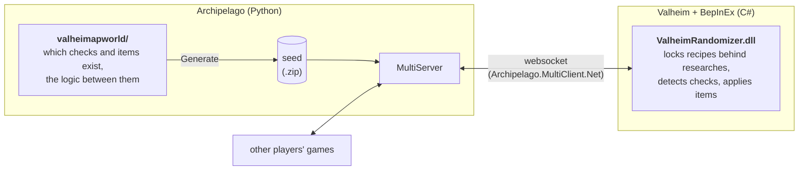
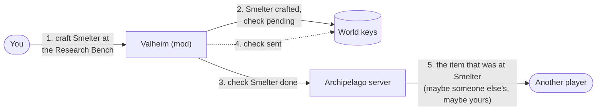
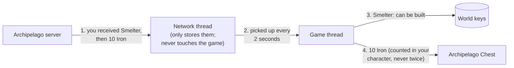
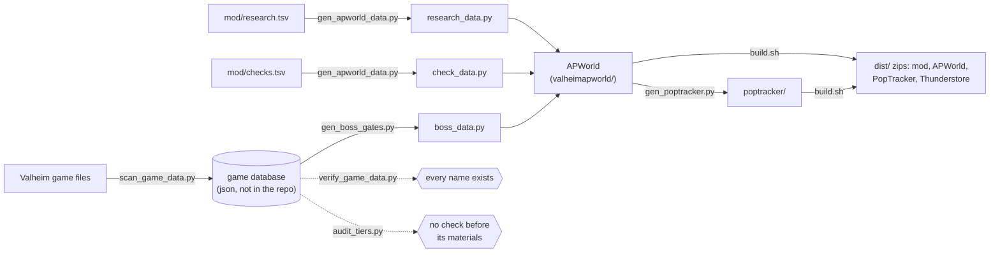

# How the Valheim randomizer works

A guide to the code for anyone maintaining it or helping players with it. For playing, see the
[README](../README.md); for problems, [TROUBLESHOOTING.md](TROUBLESHOOTING.md).

## The big picture

There are two halves:

- **The APWorld** (`valheimapworld/`, Python) runs once, when the multiworld is generated. It decides
  which checks and items are in a seed and the logic that makes sure every seed can be beaten.
- **The mod** (`src/`, C#) runs in the game. It knows checks and items only **by name**, and talks to the
  Archipelago server while you play.

They share three data files in `mod/`, so a name always means the same thing on both sides:

| File | One line per | Columns |
|---|---|---|
| `research.tsv` | research | icon item, research id, display name, description, prerequisite research ids, cost, unlocked recipes and pieces, tier, category |
| `trophies.tsv` | trophy research | trophy prefab, research id, boost type, tier |
| `checks.tsv` | extra check | kind, key, location name, tier, required research items |

`research.tsv` and `trophies.tsv` are installed next to the DLL; `checks.tsv` is built into the DLL.

## The mod

| File | What it does |
|---|---|
| `ValehimRandomizer.cs` | Plugin entry point: config, Harmony patches, loading the `.tsv` files, research flow, the 2-second tick |
| `RandomizerUtils.cs` | Creates the Research Bench and the research items and recipes; research cost percentage |
| `Patches.cs` | Harmony patches: recipe and piece locking, trophy boosts, and hooks for eat, build, buy, tame, kill and Death Link |
| `ArchipelagoConnection.cs` | Connecting, sending checks, receiving items, the goal |
| `ArchipelagoExtras.cs` | Every check beyond researches and trophies, the Archipelago Chest, bundles, boss drops, tools, traps, boosts |
| `ArchipelagoLinks.cs` | Death Link, Trap Link, Energy Link, the item feed and the `/ap` chat command |
| `ArchipelagoUI.cs` | The connection window on the main menu |

### Researches lock the game

At startup (`DoOnPrefabsAvailable`) the mod registers the **Research Bench** and, for every line of
`research.tsv`, a research **item** (a renamed copy of Amber) with a recipe at the bench. The recipe costs
the research's materials (scaled by `research_cost_percent`) and needs its prerequisite researches.

Every recipe and building piece listed in a research's "unlocks" column is **locked**:
`Patches.cs` patches `Player.HaveRequirements` so the game thinks you lack the materials until the
research is unlocked. A research is unlocked when the world has a **global key** named after it (for
example `researchSmelter`). Global keys are saved with the world and shared by everyone on it.

### Doing a research sends a check

1. You craft a research at the bench; the research item lands in your inventory.
2. `OnInventoryChanged` sees it, removes it and calls `UnlockResearch`.
3. That sets `<research>_crafted` (so the bench shows "(Completed)") and **sends the check**.
   It does *not* unlock the research: in a randomized game the unlock is an item somewhere in the
   multiworld.

Trophies work the same way, except they're never consumed: picking one up sends its check.

### Sending checks

`ArchipelagoConnection.SendLocation(name)` sets a world key `ap_pending:<name>` and tries to send at once;
every 2 seconds, `TryFlushPendingLocations` sends anything still pending and marks it `ap_sent:<name>`.
Because they're world keys:

- checks done while disconnected are sent on the next connect,
- in co-op, a player who isn't connected sets the pending key and the connected player sends it.

**Randomized mode** (`ValheimRandomizer.Randomized`) is on while connected, or in a world marked with the
`ap_world` key, which is set the first time a connected player plays in it. So co-op partners and offline
play need no setting. A world that has never been connected runs the research system on its own:
crafting a research unlocks it directly (Samupo's original "vanilla" mode).

Key names use the location name lowercased with spaces as underscores (Valheim splits global keys at
the first space). Checks that aren't in the connected seed (options, goal) are marked sent without sending.

### Receiving items

Items arrive on the network thread, where touching the game isn't safe, so the mod only reads them from
the 2-second tick, on the game's main thread (`TryGetAllItems`):

- **research items** set the research's world key: the recipes and pieces unlock,
- **trophy research items** do the same and give a permanent boost (carry weight, health, stamina,
  regeneration, armor or damage; see the boost patches in `Patches.cs`),
- **everything else** goes to `ArchipelagoExtras.ProcessItems`.

`ProcessItems` handles items that can arrive more than once by **counting**: how many bundles, traps,
boosts and kits it has handled is stored in the character (`Player.m_customData`, keyed by seed, slot and
world), so nothing is applied twice or lost across restarts.

- **Bundles, boss drops and tools** go into an **Archipelago Chest** (a piece cloned from the wooden
  chest). Delivery waits, in order, while there's no chest loaded nearby or it's full.
- **Traps** fire one at a time, at least 10 seconds apart. Weather traps force an environment for a
  while; Floor Is Lava burns you every tick unless you're on a piece or a boat.
- **Boosts** raise a skill or add a status effect. The **Starter Kit** goes straight into the inventory.

### The other checks

`checks.tsv` (embedded in the DLL) lists every check beyond researches and trophies:

| Kind | Detected by |
|---|---|
| biome, skill, discover, explore | the 2-second tick: current biome, skill levels, `Location.GetLocation`, the minimap's explored pixels (every 15 s) |
| obtain, catch | inventory changes (anything picked up or crafted) |
| eat, build, buy, tame, kill | patches on `Player.EatFood`, `Player.PlacePiece`, `Trader.OnBought`, `Tameable.Tame`, `Character.OnDeath` |

Kill checks are keyed by the trophy in the creature's drop table, so every variant of a creature counts.

### The goal

Picking up the goal boss's trophy (from slot data) calls `CompleteGame`, which tells the server once per
world (keys `ap_goal_pending` / `ap_goal_sent`).

### Links with other games

`ArchipelagoLinks.cs`:

- **Death Link**: the library's DeathLink service. Your death is sent after the amnesty count; a received
  one kills you (like the game's `die` command), wounds you or fires a trap, by `death_link_mode`.
- **Trap Link**: a `Bounce` packet tagged `TrapLink` with the trap's name; received names are matched to
  the closest Valheim trap.
- **Energy Link**: the team's `EnergyLink<team>` key in the server's data storage; `/ap deposit` and
  `/ap withdraw` convert Coins (1 Coin = 1 MJ). Withdrawals subtract and clamp at 0 in one operation and
  read the server's reply themselves (the library's reply callback never fires).

## The APWorld

| File | What it holds |
|---|---|
| `Items.py`, `Locations.py`, `Regions.py` | the item, location and tier tables (as CSV text) |
| `Options.py` | every option, option groups and presets |
| `research_data.py`, `check_data.py`, `boss_data.py` | **generated** tables (see Tools) |
| `__init__.py` | the World: building the seed |
| `docs/` | the game info page and setup guide for the Archipelago website |

**IDs** are assigned in table order, so new items and locations are **always added at the end**.

### Tiers

`Regions.py` is a chain of regions `Tier0` → `Tier12`; each step needs some research items (the tools of
that stage: the antler pickaxe, the smelter, bronze...). Every location sits in a tier. Roughly:
0-1 Meadows and Black Forest, 3 copper, 4 Swamp, 6 iron, 7 Mountains, 8 Plains, 9-10 Mistlands,
11 Ashlands, 12 Deep North.

### Building a seed (`__init__.py`)

1. **`generate_early`** works out the **scope**: every location up to the goal boss's tier, minus anything
   that needs the goal boss (or a later one) defeated first, minus researches whose prerequisites are out
   of scope, minus checks turned off by options.
2. **`create_regions`** creates the tiers and the locations in scope, plus an **event** at each boss's
   trophy: "Eikthyr Defeated"..., and "Victory" for the goal boss.
3. **`create_items`** adds one item per research and trophy in scope, the drops of the bosses before the
   goal, tools from the goal's era and the Starter Kit; every other check gets a trap, boost or bundle.
4. **`set_rules`** adds the logic: research prerequisites, the stations some checks need, and **boss
   gates**: a location or tier that needs a boss's drop needs "<Boss> Defeated" **or** that drop as an
   item (Haldor's boss-unlocked stock needs the kill itself).
5. **`fill_slot_data`** sends the mod the goal trophy, research cost, link settings and, for Universal
   Tracker, the options that decide which locations exist.

## Tools and the data pipeline

| Tool | What it does | Run it |
|---|---|---|
| `scan_game_data.py` | reads every game file into one database: items, recipes, pieces, creatures and drops, locations, spawns, altars, traders, fish... (about 25 minutes) | after a Valheim update |
| `verify_game_data.py` | checks every name the randomizer uses against the database | after a Valheim update, or editing the tables |
| `gen_apworld_data.py` | writes `research_data.py` and `check_data.py` | after editing `research.tsv` or `checks.tsv` |
| `gen_boss_gates.py` | writes `boss_data.py`: which bosses each research and check needs | after editing the tables |
| `audit_tiers.py` | flags checks placed in a tier before their materials | after editing the tables |
| `gen_poptracker.py` | writes the PopTracker pack from the APWorld's own tables | before a release |
| `gen_template.sh` | regenerates `docs/Valheim.yaml`, the options template, with Archipelago's own generator | before a release |
| `make_icon.py` | draws the Thunderstore icon | when changing the icon |
| `extract_game_data.py`, `extract_localization.py` | the older, smaller extraction, and the English names | for English names |
| `test_generate.sh <goal> <n>` | generates seeds and checks they can be beaten | after any APWorld change |
| `ap_tests.sh` | runs Archipelago's own test suites for this world | before a release |
| `net_test.sh` | runs the mod's network code against a live server | after changing the links or connection code |

## Adding a check: an example

To add "Obtain: Amber":

1. Add a line to `mod/checks.tsv`: `obtain`, `Amber`, `Obtain: Amber`, its tier, any research it needs.
2. Run `tools/gen_apworld_data.py`, `tools/gen_boss_gates.py <database>`, `tools/audit_tiers.py <database>`
   and `tools/verify_game_data.py <database>`.
3. Run `./build.sh`, `tools/test_generate.sh fader 3` and `tools/ap_tests.sh`; regenerate the PopTracker pack.

No C# changes: the mod reads the new line from the embedded `checks.tsv`.

## Things that bit us

- **Global keys split at the first space**: "ap_sent:clubs tier 1" was stored as "ap_sent:clubs". Keys
  now use underscores.
- **Network thread**: never touch the game from the Archipelago library's callbacks; queue and handle the
  work in the tick.
- **Item links** create a group world that skips `generate_early`; anything it calls must work without it.
- **Mod managers** install into a subfolder of `BepInEx/plugins`; data files are found next to the DLL.
- **Energy Link** on a new multiworld: the server can't add to a key that doesn't exist, so the mod
  creates it (at 0) when connecting.
- **Game data**: some location lists carry a stale `m_prefabName`; `m_name` is the real one.
